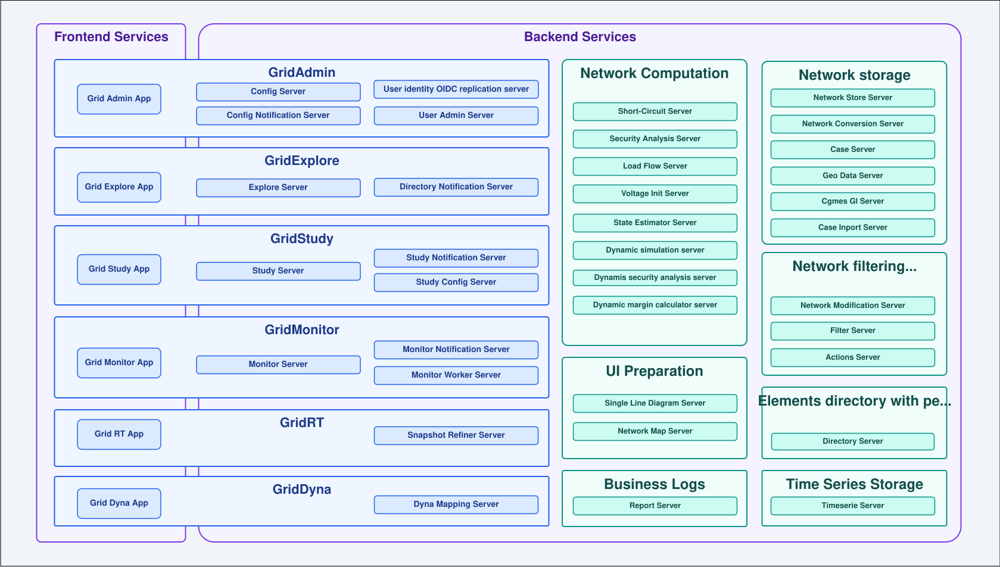

## Micro-services description

You can find here a diagram of the micro-services of the application. The diagram is a simplified view of the system architecture and does not include all the details. For instance, it does not include all the interactions between micro-services. The goal is to give a high-level overview of the system architecture and to show how micro-services are organized.

The diagram organizes the system in two complementary ways:
- **By application**: each front-end application together with the backend micro-services it directly depends on.
- **By shared backend domain**: micro-services providing a transversal capability (storage, computation, filtering, etc.) reused by several applications.

Not all the micro-services are exposed to the outside world. Only a selected set of endpoints are exposed to the outside world and front-end applications. For more details, see [Endpoints Exposure Strategy](EndPointsExposureStrategy.md).

## Applications

### GridAdmin

| Title | Repository | Description |
|---|---|---|
| Grid Admin App | [gridadmin-app](https://github.com/gridsuite/gridadmin-app) | Administration front-end for user management, profiles and announcements. Relies on **User Admin Server** for user/profile data, **Config Server** and **Config Notification Server** to persist and sync UI settings, and **User identity OIDC replication server** to display user names. |
| User Admin Server | [user-admin-server](https://github.com/gridsuite/user-admin-server) | Backend for **Grid Admin App**: manages user lifecycle, role-based access control, and user profiles (bundling parameter sets and operation quotas). |
| User identity OIDC replication server | [user-identity-oidc-replication-server](https://github.com/gridsuite/user-identity-oidc-replication-server) | Used by **Grid Admin App** (and other front-ends) to resolve a user's `sub` to a display name, without querying the identity provider directly. |
| Config Server | [config-server](https://github.com/gridsuite/config-server) | Used by **Grid Admin App** (and all front-ends) to persist per-user UI configuration parameters across machines and browsers. |
| Config Notification Server | [config-notification-server](https://github.com/gridsuite/config-notification-server) | Pushes configuration update notifications and global announcements to **Grid Admin App** (and all front-ends) via WebSocket. |

### GridExplore

| Title | Repository | Description |
|---|---|---|
| Grid Explore App | [gridexplore-app](https://github.com/gridsuite/gridexplore-app) | File/directory management front-end: directory navigation, element management (studies, cases, filters, …), study/case creation, and sharing permissions. Relies on **Explore Server** as its backend entry point and **Directory Notification Server** for real-time directory updates. |
| Explore Server | [explore-server](https://github.com/gridsuite/explore-server) | Backend entry point for **Grid Explore App**: orchestrates requests to the other data services (studies, cases, filters, contingency lists, …) and the directory tree organising them. |
| Directory Notification Server | [directory-notification-server](https://github.com/gridsuite/directory-notification-server) | Pushes directory/element update events to **Grid Explore App** via WebSocket, applying per-user visibility and filtering rules. |

### GridStudy

| Title | Repository | Description |
|---|---|---|
| Grid Study App | [gridstudy-app](https://github.com/gridsuite/gridstudy-app) | Front-end to create and manage studies: import cases, create network variants, run simulations, and visualize network data and results. Relies on **Study Server** as its backend entry point, **Study Notification Server** for live updates, and **Study Config Server** for display/layout preferences. |
| Study Server | [study-server](https://github.com/gridsuite/study-server) | Backend entry point for **Grid Study App**: manages power system studies, with root networks organised in a network modification tree, dispatching requests to downstream services. |
| Study Notification Server | [notification-server](https://github.com/gridsuite/notification-server) | Forwards study-related update messages (and user quota updates) to **Grid Study App** via WebSocket. |
| Study Config Server | [study-config-server](https://github.com/gridsuite/study-config-server) | Stores **Grid Study App**'s user-defined display and layout configurations: spreadsheet configurations, network visualization parameters, diagram grid layouts, workspaces and computation result filters. |

### GridMonitor

| Title | Repository | Description |
|---|---|---|
| Grid Monitor App | [gridmonitor-app](https://github.com/gridsuite/gridmonitor-app) | Front-end used to configure, compare and launch grid monitoring calculation processes (e.g. N-k security analysis) and monitor their execution. Relies on **Monitor Server** (BFF), **Monitor Worker Server** (computation execution) and **Monitor Notification Server** (live status updates). |
| Monitor Server | [monitor-core](https://github.com/gridsuite/monitor-core) | BFF for **Grid Monitor App**: manages process configurations, launches executions asynchronously, tracks execution/step statuses in PostgreSQL, and publishes run requests to RabbitMQ. |
| Monitor Worker Server | [monitor-core](https://github.com/gridsuite/monitor-core) | Executes the computation pipelines (e.g. load flow, security analysis) triggered via the Monitor Server on behalf of **Grid Monitor App**, updates statuses, and stores results or debug artifacts. |
| Monitor Notification Server | [monitor-notification-server](https://github.com/gridsuite/monitor-notification-server) | Pushes process execution status updates to **Grid Monitor App** via WebSocket. |

### GridRT

| Title | Repository | Description |
|---|---|---|
| Grid RT App | [gridrt-app](https://github.com/gridsuite/gridrt-app) | Front-end to manage the snapshot refiner process: configure and launch the process, monitor its status in real time, and view results and logs. Consumes the REST API exposed by the **Snapshot Refiner Server**. |
| Snapshot Refiner Server | Not available yet | |

### GridDyna

| Title | Repository | Description |
|---|---|---|
| Grid Dyna App | [griddyna-app](https://github.com/gridsuite/griddyna-app) | Creates a mapping between network equipment and their dynamic model representation, generating `.dyd`/`.par` files for dynamic simulators and previewing how equipment will be modeled. Relies on **Dyna Mapping Server** to resolve mappings between network equipment and dynamic models. |
| Dyna Mapping Server | [dynamic-mapping-server](https://github.com/gridsuite/dynamic-mapping-server) | Backend for **Grid Dyna App**: maps network equipment to dynamic simulation models used by dynamic simulation tools (e.g. Dynawo). Manages mappings, dynamic models (parameters, variables) and exports parameter sets to the `.par` format. |

## Shared backend services

### Network storage

| Title | Repository | Description |
|---|---|---|
| Network Store Server | [powsybl-network-store-server](https://github.com/powsybl/powsybl-network-store-server) | Database-backed implementation of the PowSyBl Core Network API (IIDM model), persisting networks in PostgreSQL instead of in memory. Used together with the `network-store-client` library. |
| Network Conversion Server | [powsybl-network-conversion-server](https://github.com/powsybl/powsybl-network-conversion-server) | Imports cases into the network store and exports networks back to case files, using PowSyBl importers/exporters. Indexes equipment in Elasticsearch and posts functional logs to the report-server during import. |
| Case Server | [powsybl-case-server](https://github.com/powsybl/powsybl-case-server) | Stores and serves power network case files in any format supported by PowSyBl (CGMES, UCTE, XIIDM, Matpower, IEEE-CDF, …). Archives are extracted and sub-files stored compressed in S3. |
| Geo Data Server | [geo-data-server](https://github.com/gridsuite/geo-data-server) | Manages geographical data (GPS coordinates) for substations and lines of a network. Computes missing substation positions with a centroid-based algorithm and falls back to default country-level positions. |
| Cgmes Gl Server | [cgmes-gl-server](https://github.com/gridsuite/cgmes-gl-server) | Extracts geographical position data (substation and line positions) from CGMES cases' GL profile and pushes the extracted coordinates to the geo-data-server. |
| Case Import Server | [case-import-server](https://github.com/gridsuite/case-import-server) | Provides a single REST endpoint to import a case file and automatically store it in a target directory of the GridSuite tree, based on the declared origin of the file, forwarding storage to case-server and directory-server. |

### Network Computation

| Title | Repository | Description |
|---|---|---|
| Short-Circuit Server | [shortcircuit-server](https://github.com/gridsuite/shortcircuit-server) | Simulates electrical faults on a network (whole network or a specific bus) and computes resulting short-circuit currents, feeder contributions, and limit violations for protection device validation. |
| Security Analysis Server | [security-analysis-server](https://github.com/gridsuite/security-analysis-server) | Runs security analysis computations, simulating a set of contingencies and detecting the resulting limit violations (current, voltage, active power), using configurable providers (OpenLoadFlow, DynaFlow). |
| Load Flow Server | [loadflow-server](https://github.com/gridsuite/loadflow-server) | Runs load flow computations on a network using configurable providers (OpenLoadFlow, DynaFlow). Detects and stores limit violations and computes energy balance per connected component and per country. |
| Voltage Init Server | [voltage-init-server](https://github.com/gridsuite/voltage-init-server) | Computes an optimal starting voltage profile (magnitudes and angles) using PowSyBl Optimizer, then translates the result into network modifications (setpoints, tap positions, …) sent to network-modification-server. |
| State Estimator Server | Not available yet | |
| Dynamic Simulation Server | [dynamic-simulation-server](https://github.com/gridsuite/dynamic-simulation-server) | Runs dynamic simulation (time-domain) computations, building a dynamic model of the network from a mapping, applying events, and running a Dynawo-based provider. Entry point of the dynamic computation chain. |
| Dynamic Security Analysis Server | [dynamic-security-analysis-server](https://github.com/gridsuite/dynamic-security-analysis-server) | Extends a dynamic simulation result by evaluating the impact of a set of contingencies on top of its output state, using a Dynawo-based dynamic security analysis provider. |
| Dynamic Margin Calculator Server | [dynamic-margin-calculation-server](https://github.com/gridsuite/dynamic-margin-calculation-server) | Evaluates, through successive load increases, the maximum load level a network can sustain before contingencies lead to a critical loss of stability, relying on the dynamic-simulation and dynamic-security-analysis servers. |

### Network filtering and modification

| Title | Repository | Description |
|---|---|---|
| Network Modification Server | [network-modification-server](https://github.com/gridsuite/network-modification-server) | Stores and applies network modifications, organised in groups tied to a study variant. Supports composite (reusable) modifications and applying changes immediately or as part of a full variant build. |
| Filter Server | [filter-server](https://github.com/gridsuite/filter-server) | Stores and instantiates filters (sets of network equipment), used to configure modifications, contingency lists, and to filter data in the UI. Evaluates filters against a network and returns matched equipment. |
| Actions Server | [actions-server](https://github.com/gridsuite/actions-server) | Stores and instantiates contingency lists (identifier-based and filter-based), used by security and sensitivity analyses. Evaluates contingency lists against a network and exports them in PowSyBl JSON format. |

### Elements directory with permissions

| Title | Repository | Description |
|---|---|---|
| Directory Server | [directory-server](https://github.com/gridsuite/directory-server) | Manages the hierarchical directory tree in which user resources (studies, filters, contingency lists, …) are organised, along with the access permissions (READ/WRITE/MANAGE) controlling who can browse or modify each directory. |

### UI Preparation

| Title | Repository | Description |
|---|---|---|
| Single Line Diagram Server | [powsybl-single-line-diagram-server](https://github.com/powsybl/powsybl-single-line-diagram-server) | Generates single-line diagrams (voltage level or substation) and network area diagrams (NAD) from a network stored in the network store, with automatic layout options. |
| Network Map Server | [network-map-server](https://github.com/gridsuite/network-map-server) | Read-only projection layer between the PowSyBl IIDM model and the UI. Exposes network equipment at different levels of detail (`MAP`, `TOOLTIP`, `TAB`, `FORM`, `OPERATING_STATUS`) so each UI context only receives the data it needs. |

### Business Logs

| Title | Repository | Description |
|---|---|---|
| Report Server | [report-server](https://github.com/gridsuite/report-server) | Stores and serves hierarchical computation reports (`ReportNode` trees) produced by PowSyBl-based calculations. Exposes them back through REST endpoints for display in the front-end (full tree view, paginated logs, aggregated severities, search). |

### Time Series Storage

| Title | Repository | Description |
|---|---|---|
| Timeseries Server | [timeseries-server](https://github.com/gridsuite/timeseries-server) | Generic, computation-agnostic storage for PowSyBl time series. Producers (e.g. dynamic-simulation-server) submit a batch of time series and get a group id; consumers later fetch the metadata or data, optionally filtered. |
